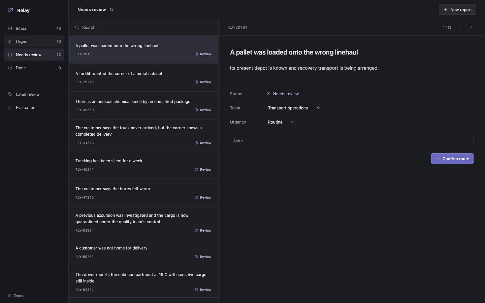

# Relay incident desk

A logistics incident triage prototype for the [SUTD Straive assessment](https://exam.sanand.workers.dev/sutd-2026-10-internship). A coordinator reads a report, checks its proposed team and urgency, corrects it and records a local decision. Urgent takes priority over ordinary review.



## Run it

Python 3.12 is verified. No paid API, AI account or Node build is required.

```sh
python3 -m venv .venv
source .venv/bin/activate
python -m pip install -r part-b/requirements.txt
cd part-b
python corpus.py
python -m unittest discover -s tests -v
python -m uvicorn app:app --host 127.0.0.1 --port 8000
```

Open [the local demo](http://127.0.0.1:8000). Reproducible run instructions are supplied instead of a public hosted service. All decisions stay local; no team is contacted. See [full instructions](part-b/README.md) for Docker and evaluation.

## Evidence

- [One-page business summary](part-b/output/pdf/business-summary.pdf)
- [60-report completed review](part-b/output/review/review_60_reports.xlsx)
- [Independent test, costs and mistakes](part-b/EVALUATION.md)
- [Original frozen results](part-b/evidence/final-test.json), [predictions](part-b/evidence/final-test-predictions.json), [mistakes](part-b/evidence/final-test-mistakes.json)
- [Current second fresh test and remaining failures](part-b/FRESH2-VALIDATION.md)
- [Second fresh test results](part-b/evidence/fresh2-20261022/fresh-test.json)
- [First fresh validation and failures](part-b/FRESH-VALIDATION.md)
- [Fresh test results](part-b/evidence/fresh-20261022/fresh-test.json)
- [Current diagnostic results](part-b/evidence/iterations/routing-v4/retest.json)
- [Data provenance](part-b/DATA.md), [requirement coverage](part-b/DELIVERABLES.md)
- [Walkthrough](part-b/WALKTHROUGH.md), [feedback](part-b/FEEDBACK.md), [collaboration and attribution](part-b/ATTRIBUTION.md)

## What the evidence says

There are 480 fictional reports: 300 development and three 60-report reference sets. Three separate fresh-context agents independently labeled the test sets using only their texts and the unchanged guide. All 180 judgments and earlier results are preserved; this is agent verification, not human domain-expert validation.

The active `routing-v4` adds primary-issue, custody and current-consequence checks. RLY-910052, the missed fire-alarm controller, now receives Safety & security/Urgent review under all four configurations. RLY-82374's cold-chain correction remains covered. Every app decision needs human confirmation.

The candidate was frozen before the second fresh set was authored and labeled. Text/Sensitive gets 49/55 clear team labels correct (89.1%), F1 0.904, zero misses among 13 known urgent cases, five false urgent alerts and 43/60 model abstentions. One wrong team outside abstention remains. The new reviewer disagreed on the primary team for three urgent critical-system blockers; those judgments remain unchanged.

On these same new reports, preserved v3 gets 46/55 teams correct (83.6%). The paired comparison was added after primary scoring with no tuning. [FRESH2-VALIDATION.md](part-b/FRESH2-VALIDATION.md) records full results, protocol, failures and synthetic/shared-model limits. No operator trial has occurred.

Manual prototype testing and feedback: **dansyar (author-reported)**. Automated checks/evaluation: **OpenAI Codex**. The 47 backend checks and 12 frontend regression checks include 32 temperature and 19 authored routing scenarios; regression fixtures are separate from independent reports. Full roles are in [ATTRIBUTION.md](part-b/ATTRIBUTION.md).

## Review and demonstration

The prototype, data, reference reviews, evaluation, changed-requirement analysis and business summary are included in this repository. Run the demo locally using the instructions above. The 24 October UI and reliability review added a separate second pass over all 60 Fresh 2 reports, with short reasons and one disclosed clarification difference. The frozen benchmark labels remain selectable and unchanged. See [UI verification](part-b/UI-VERIFICATION.md) and the [latest completed review](part-b/output/review/review_latest_60.csv).
